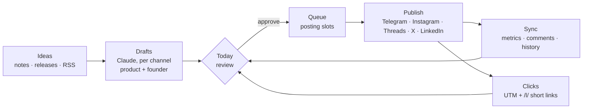

<p align="center">
  <picture>
    <source media="(prefers-color-scheme: dark)" srcset=".github/assets/logo-dark.svg">
    
  </picture>
</p>

<p align="center">
  <strong>The distribution factory for indie hackers.</strong><br>
  Turn what you ship into posts — from each product <em>and</em> from you, the founder —<br>
  on Telegram, Instagram, Threads, X and LinkedIn. Self-hosted, one <code>docker compose up</code>.
</p>

<p align="center">
  <a href="#quick-start"><strong>Quick start</strong></a> ·
  <a href="#connecting-channels">Connecting channels</a> ·
  <a href="#how-it-works">How it works</a> ·
  <a href="#configuration">Configuration</a> ·
  <a href="README.uk.md">Українська</a> ·
  <a href="README.ru.md">Русский</a>
</p>

<p align="center">
  &nbsp;&nbsp;
  &nbsp;&nbsp;
  &nbsp;&nbsp;
  &nbsp;&nbsp;
  
</p>

<p align="center">
  
  
  
  
  
  
</p>

<p align="center">
  
</p>

## Why

Building products is the fun part. Distribution is the part that quietly doesn't happen: every release needs a post per platform, your personal account needs its own voice, and nobody tells you which of those posts actually brought users.

Loudloop is a conveyor for that:

- **Ideas in** — notes, product events (GitHub releases, changelogs) and RSS feeds.
- **Drafts out** — Claude writes a platform-native variant for every channel: a hook for X, a takeaway for LinkedIn, a lively voice for Telegram.
- **Two angles per release** — the product announces it, *and* you post it in first person, while a promo cap keeps your personal account personal.
- **You only approve** — one click puts a draft into the next free slot of your posting rhythm.
- **Clicks, not vanity** — every link gets UTM tags and an optional own short link, so you see which post brought people to which product.

## Features

| | |
| --- | --- |
|  |  |
| **Overview** — monthly follower goals with the expected pace, AI one-liners, growth chart per channel. | **Ideas** — notes, product events and feed items; one idea becomes drafts from the product and from you. |
|  |  |
| **Composer** — shared text plus a native variant per channel, live limits (X counts links as 23 chars). | **Clicks** — own short links with UTM: clicks by product, channel and post. |
|  |  |
| **Queue** — posting slots per channel; approved drafts take the next free slot. | **Connect** — OAuth for Instagram, Threads, X and LinkedIn; a bot plus in-app sign-in for Telegram. |

**Also inside**

- **Projects.** Your personal brand plus any number of products, each with its own channels, brief, queue, inbox and read-only share link. `/all` aggregates them.
- **History sync.** Already-published posts, metrics and comments are imported on connect; posts published natively are picked up every hour.
- **Replies inbox** across platforms, a **People** view of your most active commenters, **Signals** (viral posts, spikes, silence, expiring tokens), **Challenges** with streaks.
- **Reliable publishing.** BullMQ jobs with retries, a Redis sent-marker against double posts, token refresh before every publish.
- **Own S3** (SeaweedFS) for media, so Meta can fetch files without exposing the dashboard.
- **Interface in English, Ukrainian and Russian**; each project writes posts in its own language.

## How it works



## Quick start

```bash
git clone https://github.com/zerox9dev/loudloop.git && cd loudloop
cp .env.example .env
# secrets (macOS sed; on Linux drop the empty quotes after -i)
sed -i '' "s|^AUTH_SECRET=.*|AUTH_SECRET=$(openssl rand -base64 32)|; s|^ENCRYPTION_KEY=.*|ENCRYPTION_KEY=$(openssl rand -base64 32)|" .env
sed -i '' "s|^S3_ACCESS_KEY_ID=.*|S3_ACCESS_KEY_ID=$(openssl rand -hex 16)|; s|^S3_SECRET_ACCESS_KEY=.*|S3_SECRET_ACCESS_KEY=$(openssl rand -hex 32)|" .env
docker compose up -d --build
```

Open **http://localhost:3000** and sign in with `ADMIN_EMAIL` / `ADMIN_PASSWORD` from `.env`. If the password is empty, one is generated on first boot: `docker compose logs web | grep ADMIN_PASSWORD`.

With `DEMO_MODE=1` you get two demo projects with 45 days of synthetic data in `DEMO_LOCALE` (en, uk or ru). Remove them in **Account → Remove demo data** once real channels are connected.

| Service | What it does |
| --- | --- |
| `web` | Next.js 16 app; runs migrations and the first seed on start |
| `worker` | BullMQ: scheduled publishing, hourly sync, history import, daily pipeline fill, RSS. Queue UI on `127.0.0.1:3001/queues` |
| `postgres` | Postgres 17 (`127.0.0.1:5433`) |
| `redis` | Redis 7, AOF on (`127.0.0.1:6380`) |
| `s3` | SeaweedFS S3 for post media (`:8333`, public read of files only) |

## Connecting channels

Open a project, then **Account → Connect a channel**. Each card shows the official way first and, if the app keys are missing, the exact setup steps with the callback URL to copy.

| Channel | How | What you get |
| --- | --- | --- |
| **Telegram** | A bot from @BotFather made admin of your channel (Telegram has no OAuth for channels), plus an in-app **Sign in to Telegram** (phone → code → 2FA) for stats | Posting; with sign-in: views, reactions, comments, history |
| **Instagram** | OAuth — *Instagram API with Instagram Login* (Business/Creator account) | Photos, reels, stories, metrics, comments, history, 30-day follower history |
| **Threads** | OAuth — *Threads API* | Posts, metrics, replies, history |
| **X** | OAuth 2.0 with PKCE, tokens refreshed automatically | Posting on the Free tier; metrics, mentions and history need Basic |
| **LinkedIn** | OAuth — *Sign In with LinkedIn (OIDC)* + *Share on LinkedIn* | Text and photo posts to your profile (stats require partner access) |

Meta, LinkedIn and X only accept **https** callbacks, so `APP_URL` must be public — Tailscale Funnel, cloudflared or your own domain. Instagram and Threads also download media by URL: expose port `8333` and set `S3_PUBLIC_URL`.

## Configuration

| Variable | Purpose |
| --- | --- |
| `APP_URL` | Public URL of the app (OAuth callbacks) |
| `AUTH_SECRET`, `ENCRYPTION_KEY` | Session signing and at-rest encryption of channel tokens (required, 32 bytes) |
| `ADMIN_EMAIL`, `ADMIN_PASSWORD`, `ADMIN_LOCALE` | First user |
| `DEMO_MODE`, `DEMO_LOCALE` | Demo data and its language |
| `ANTHROPIC_API_KEY`, `ANTHROPIC_MODEL` | Claude for drafts and insights (default `claude-opus-5-5`); without a key, templates are used |
| `LINKS_BASE_URL` | Public address serving `/l/*` — enables own short links and click counting |
| `S3_*` | Media storage; `S3_PUBLIC_URL` is what Meta fetches |
| `TELEGRAM_API_ID`, `TELEGRAM_API_HASH` | From my.telegram.org — needed for Telegram sign-in (stats, comments, history) |
| `INSTAGRAM_APP_ID/SECRET`, `THREADS_APP_ID/SECRET`, `X_CLIENT_ID/SECRET`, `LINKEDIN_CLIENT_ID/SECRET` | OAuth apps |
| `TZ` | Time zone for slots and daily stats |

## Development

```bash
pnpm install
docker compose up -d postgres redis s3
pnpm db:migrate && pnpm db:seed
pnpm dev        # http://localhost:3000
pnpm worker     # queues, in a second terminal
```

| Command | |
| --- | --- |
| `pnpm test` | Vitest: adapters (recorded API responses), publishing idempotency, importer, factory, links, i18n parity |
| `pnpm test:e2e` | Playwright against a running stack |
| `pnpm lint` · `pnpm typecheck` | |
| `pnpm db:generate` | New migration after changing `lib/db/schema.ts` |

**Stack:** Next.js 16 · React 19 · shadcn/ui · Tailwind 4 · next-intl · Drizzle · Postgres 17 · BullMQ · Redis · SeaweedFS · grammY · GramJS · twitter-api-v2 · Graph APIs · Claude.

```
app/(app)/[project]/*   dashboard pages, scoped to a project from the URL
app/l/[code]            public short-link redirect
lib/providers/*         channel adapters: publish · stats · metrics · comments · posts history
lib/services/*          publish (idempotent), sync, importer, factory, generator, links, slots
lib/actions/*           server actions
worker/index.ts         queues and schedules
messages/{en,uk,ru}.json
```

## License

[GNU AGPL-3.0](LICENSE). You can use, modify and self-host Loudloop freely; if you run a modified version as a network service, you must publish your changes under the same license.
