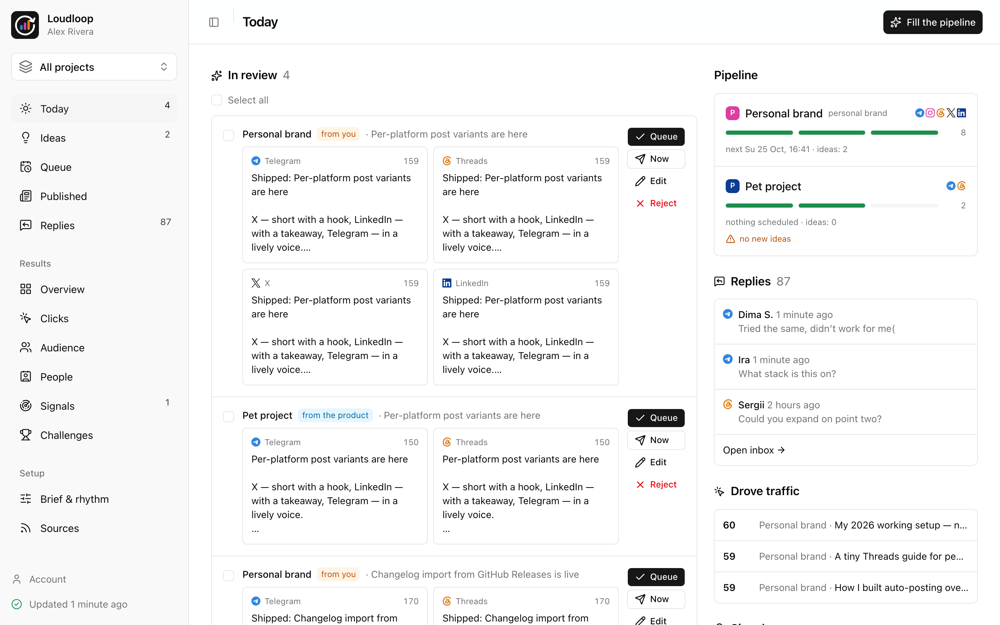
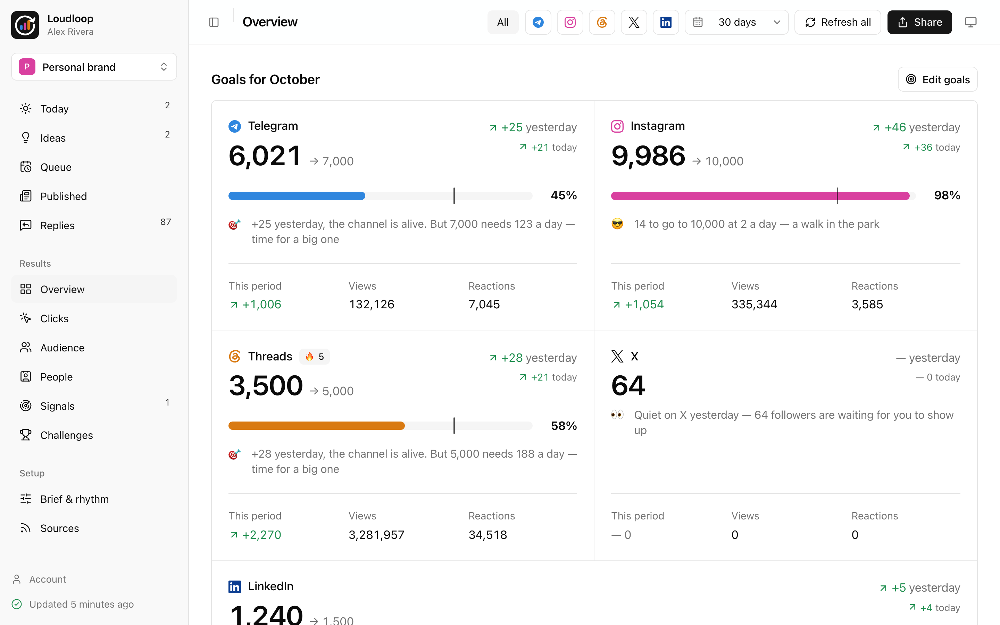
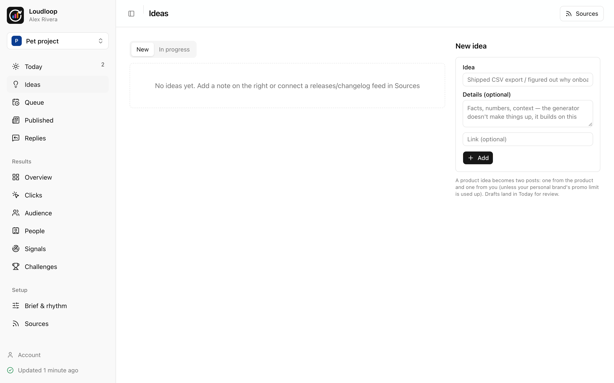
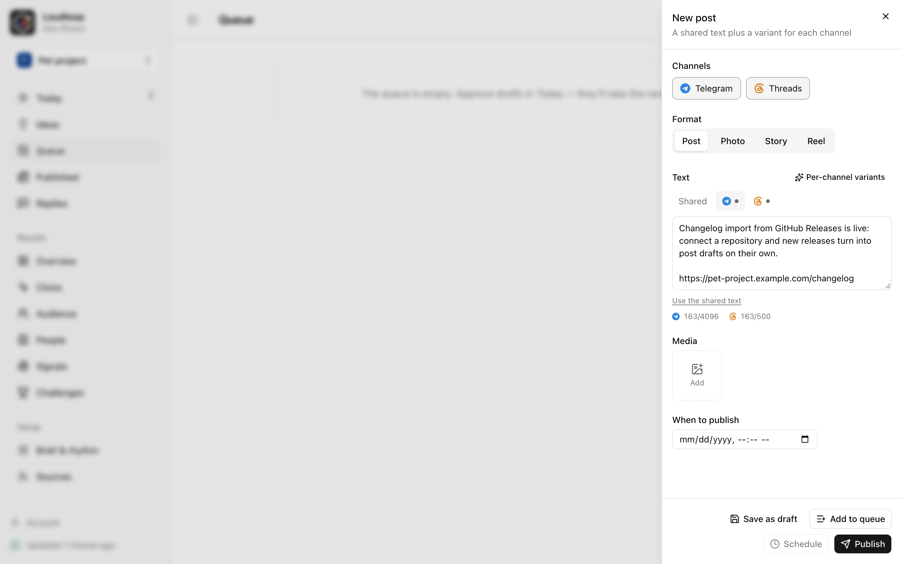
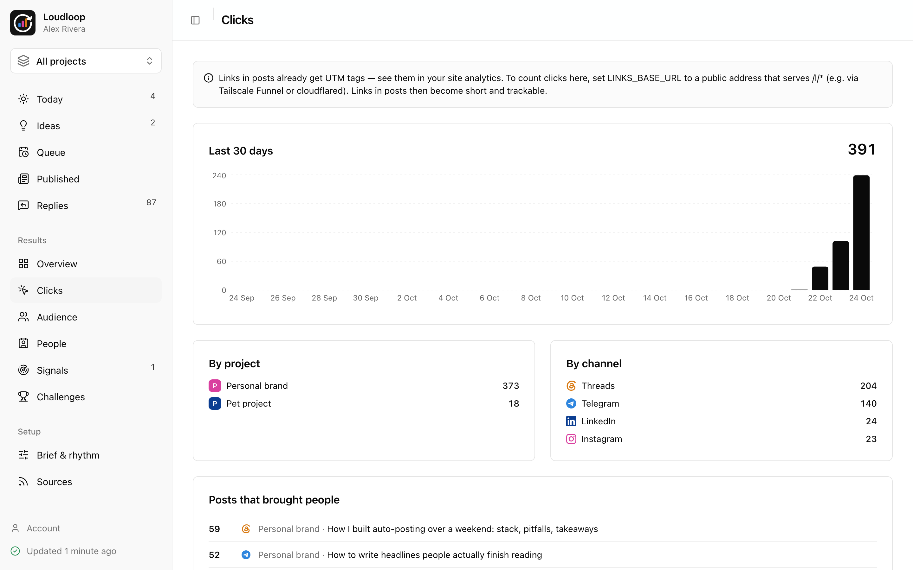
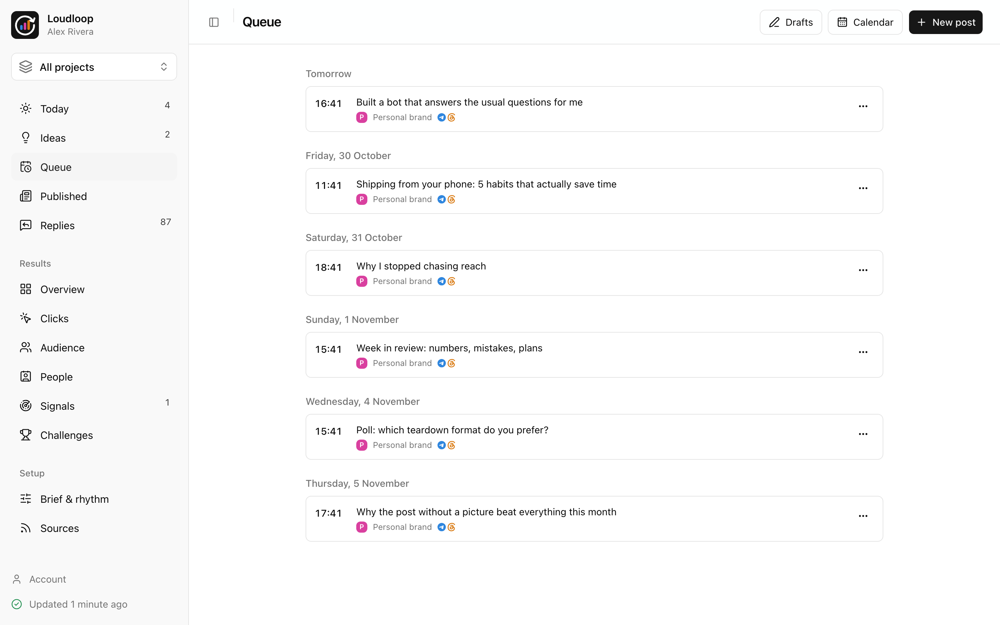
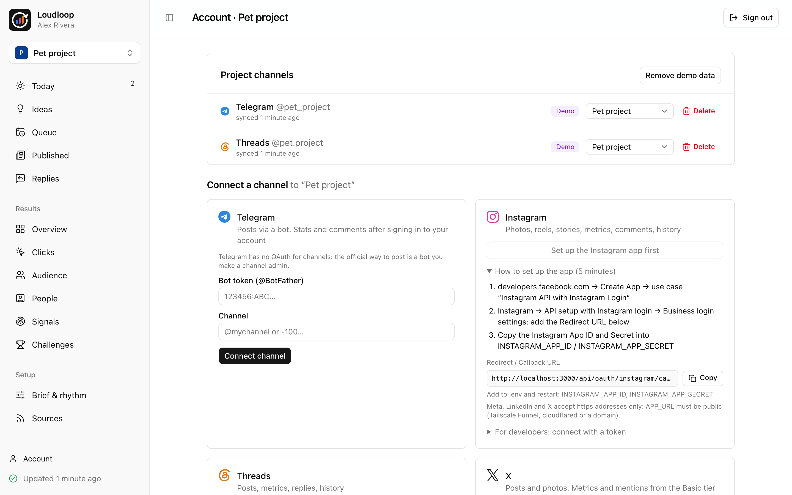

<p align="center">
  <picture>
    <source media="(prefers-color-scheme: dark)" srcset=".github/assets/logo-dark.svg">
    
  </picture>
</p>

<p align="center">
  <strong>Завод дистрибуции для инди-хакера.</strong><br>
  Превращает то, что вы шипите, в посты — от каждого продукта <em>и</em> от вас как основателя —<br>
  в Telegram, Instagram, Threads, X и LinkedIn. Self-hosted, один <code>docker compose up</code>.
</p>

<p align="center">
  <a href="README.md">English</a> · <a href="README.uk.md">Українська</a>
</p>

<p align="center">
  
</p>

## Зачем

Делать продукты — интересно. Дистрибуция — то, что тихо не происходит: каждый релиз требует поста под каждую площадку, личному аккаунту нужен свой голос, и никто не говорит, какой пост реально привёл пользователей.

Loudloop — конвейер для этого:

- **На входе идеи** — заметки, события продукта (GitHub releases, changelog) и RSS-ленты.
- **На выходе черновики** — Claude пишет нативный вариант под каждую площадку: хук для X, вывод для LinkedIn, живой тон для Telegram.
- **Два ракурса на релиз** — продукт анонсирует, *и* вы пишете от первого лица; лимит промо бережёт личный аккаунт от рекламы.
- **Вы только одобряете** — одним кликом черновик встаёт в ближайший слот вашего ритма.
- **Клики, а не тщеславие** — каждая ссылка получает UTM и по желанию свою короткую ссылку: видно, какой пост привёл людей в какой продукт.

## Возможности

| | |
| --- | --- |
|  |  |
| **Обзор** — цели на месяц с нормой темпа, AI-комментарии, график роста. | **Идеи** — из одной идеи черновики от продукта и от вас. |
|  |  |
| **Редактор** — общий текст + вариант под каждую площадку с лимитами. | **Переходы** — свои короткие ссылки с UTM по продуктам, площадкам и постам. |
|  |  |
| **Очередь** — слоты публикаций для каждой площадки. | **Подключение** — OAuth для Instagram, Threads, X и LinkedIn; бот и вход в аккаунт для Telegram. |

**А ещё:** проекты (личный бренд + любое число продуктов), импорт истории при подключении и ежечасная синхронизация, общий инбокс ответов, «Люди», сигналы, челленджи, надёжная публикация с повторами и защитой от дублей, свой S3 для медиа, интерфейс на английском, украинском и русском — и свой язык постов у каждого проекта.

## Быстрый старт

```bash
cp .env.example .env
sed -i '' "s|^AUTH_SECRET=.*|AUTH_SECRET=$(openssl rand -base64 32)|; s|^ENCRYPTION_KEY=.*|ENCRYPTION_KEY=$(openssl rand -base64 32)|" .env
sed -i '' "s|^S3_ACCESS_KEY_ID=.*|S3_ACCESS_KEY_ID=$(openssl rand -hex 16)|; s|^S3_SECRET_ACCESS_KEY=.*|S3_SECRET_ACCESS_KEY=$(openssl rand -hex 32)|" .env
docker compose up -d --build
```

Откройте **http://localhost:3000** и войдите с `ADMIN_EMAIL` / `ADMIN_PASSWORD` из `.env` (пустой пароль генерируется при первом запуске: `docker compose logs web | grep ADMIN_PASSWORD`). Язык демо-данных и интерфейса задают `DEMO_LOCALE` и `ADMIN_LOCALE` (`ru`).

## Подключение площадок

Откройте проект → **Аккаунт → Подключить площадку**. Каждая карточка показывает официальный способ, а если ключей приложения нет — пошаговую настройку с callback URL для копирования.

| Площадка | Как | Что получаете |
| --- | --- | --- |
| **Telegram** | Бот из @BotFather админом канала (OAuth для каналов у Telegram нет) + вход в аккаунт в панели (телефон → код → 2FA) | Публикация; после входа — просмотры, реакции, комментарии, история |
| **Instagram** | OAuth (Instagram API with Instagram Login) | Фото, рилсы, сторис, метрики, комментарии, история |
| **Threads** | OAuth (Threads API) | Посты, метрики, ответы, история |
| **X** | OAuth 2.0 с PKCE, токены обновляются сами | Публикация на Free; метрики и история — с Basic |
| **LinkedIn** | OAuth (Sign In with LinkedIn + Share on LinkedIn) | Посты и фото в профиль |

Meta, LinkedIn и X принимают только **https**-callback, поэтому `APP_URL` должен быть публичным (Tailscale Funnel, cloudflared или домен). Для медиа Instagram и Threads откройте порт `8333` и задайте `S3_PUBLIC_URL`.

Полный список переменных — в [README на английском](README.md#configuration).

## Лицензия

[GNU AGPL-3.0](LICENSE). Можно свободно использовать, менять и разворачивать у себя; если вы запускаете изменённую версию как сетевой сервис, изменения нужно опубликовать под той же лицензией.
